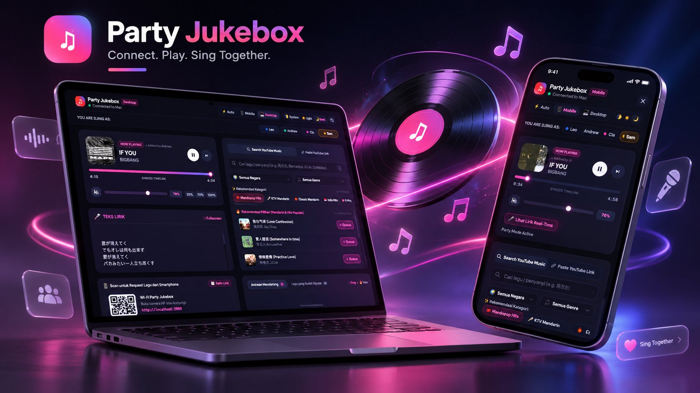
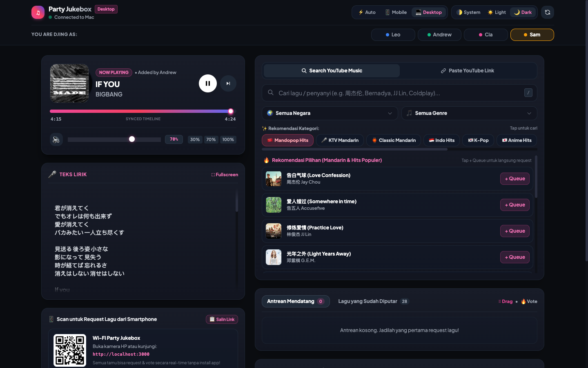
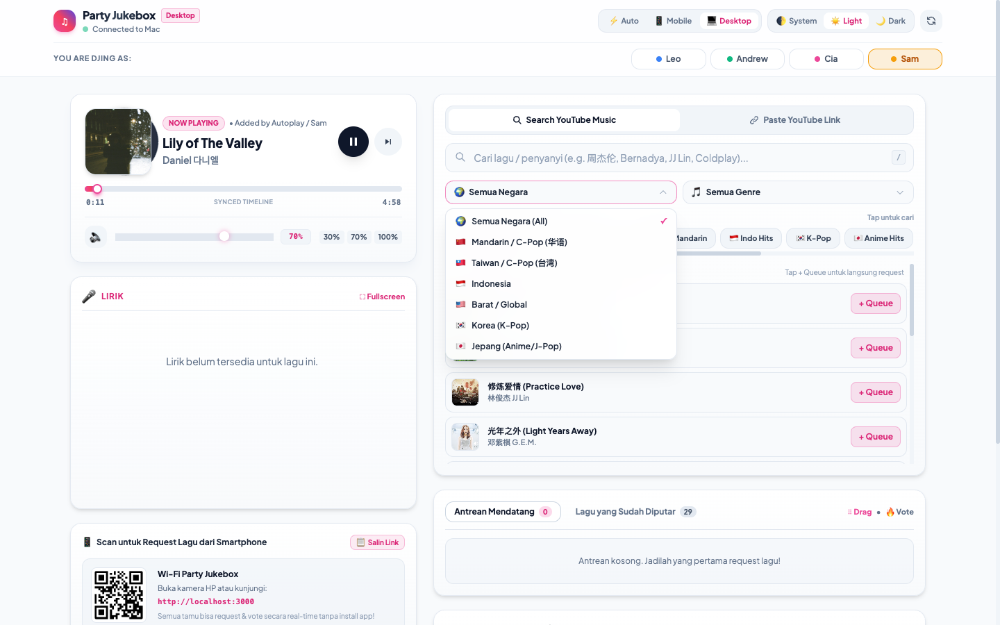
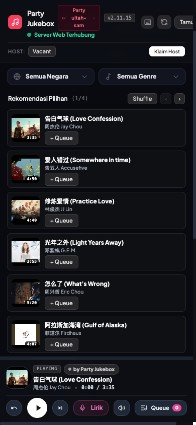
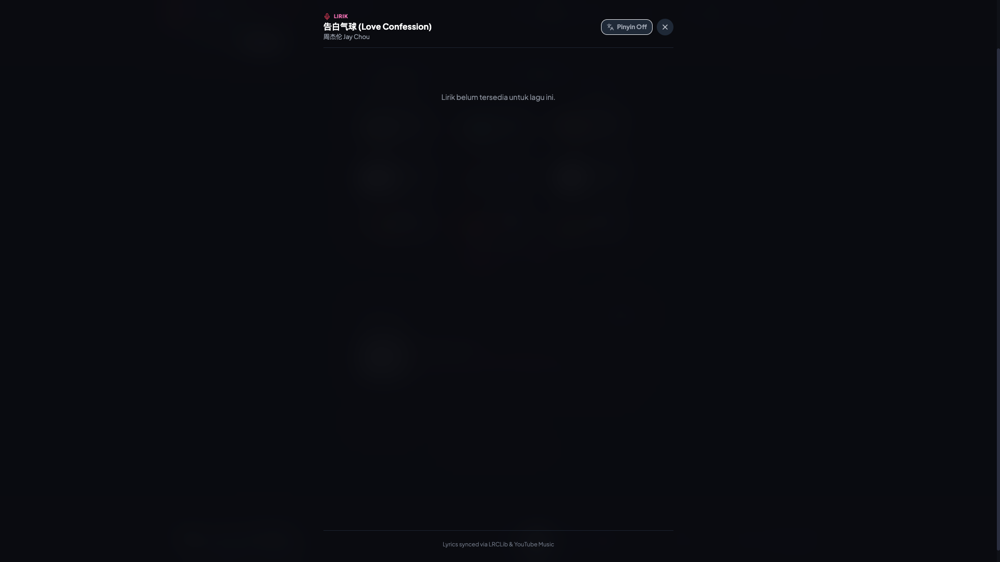

<div align="center">



# 🎵 Party Jukebox
### Connect. Play. Sing Together.

> **Collaborative, real-time social jukebox & karaoke hub for house parties, roadtrips, and hangouts.**  
> Host your music on a laptop connected to speakers with YouTube Music Premium (lossless, ad-free), while friends control the queue, vote, read karaoke lyrics, and DJ from their phones—**no app installation and zero login required for guests!**

[](https://github.com/sammmms/jukebox)
[](LICENSE)
[](https://nodejs.org)
[](https://tailwindcss.com)

</div>

---

## 📸 Showcase & Preview

<div align="center">

### 💻 Widescreen Desktop Dashboard (Dark Mode)


<br/>

### ☀️ Apple-Style Glassmorphic Light Theme & Custom Select


<br/>

| 📱 Mobile Phone View (iPhone) | 🎤 Synced Karaoke Real-Time Lyrics |
| :---: | :---: |
|  |  |

</div>

---

## ✨ Features

- 🎧 **Host Once, Stream Anywhere:** 1 Host machine (Mac, Windows, or Linux) plays music to your home speakers or sound system with zero background ad interruptions.
- 📱 **Zero Friction for Friends:** Guests simply scan the host QR code or open the local Wi-Fi URL in Safari / Chrome on any iOS or Android smartphone.
- 💻 **Desktop Widescreen & Mobile View Switcher:**
  - `⚡ Auto`: Automatically switches between mobile phone layout and wide 2-column desktop dashboard.
  - `📱 Mobile`: Forces compact smartphone view on any monitor.
  - `💻 Desktop`: Expands into a 2-column command center with embedded lyrics and host QR panel.
- 🌓 **System Theme Matching:** Automatically follows macOS / iOS / Android dark or light mode schedule via `matchMedia`, with manual overrides (`🌓 System` / `☀️ Light` / `🌙 Dark`).
- 🇨🇳 **Mandarin / C-Pop (华语) Music Discovery:**
  - Dedicated `🇨🇳 Mandarin / C-Pop (华语)` & `🇹🇼 Taiwan / C-Pop (台湾)` country filters.
  - Preloaded with Mandopop chips: `🇨🇳 Mandopop Hits`, `🎤 KTV Mandarin`, `🏮 Classic Mandarin`.
  - Curated party recommendations: 周杰伦 Jay Chou, 林俊杰 JJ Lin, 邓紫棋 G.E.M., 告五人 Accusefive, 周兴哲 Eric Chou, 菲道尔 Firdhaus.
- 🧩 **Polished Custom Components:**
  - **`CustomSelect`**: Glassmorphic floating popover with custom flags, animated rotating chevrons, and click-outside dismissal.
  - **`CustomSearchInput`**: Instant clear button `✕`, loading spinner, and keyboard shortcut `/` or `⌘K`.
  - **`CustomTimeline`**: Spotify-grade glowing playhead dot (`shadow-pink-500/80`) and monospace time tracker.
  - **`CustomVolumeControl`**: Dynamic speaker emoji (`🔇`, `🔈`, `🔉`, `🔊`), percentage badge, and 1-tap presets (`30%`, `70%`, `100%`).
  - **`CustomHostShare`**: 1-click `📋 Salin Link` button with instant clipboard copy feedback.
- 🎤 **Real-Time Karaoke Synced Lyrics:** Syllable/line-accurate synced lyrics via LRCLib with auto-scrolling glow highlight and fade masks.
- ⏭️ **Up Next Preview & Autoplay Labeling:** Displays the upcoming track directly under Now Playing with 1-tap `Play Now ⏭️`, distinguishing guest requests (`by [User]`) from YouTube's `✨ Autoplay YouTube`.
- 🛡️ **COPPA "Made for Kids" Auto-Resume Watchdog:** Automatically bypasses YouTube Music's miniplayer auto-pause restriction on anime and kids' songs without physical intervention.
- 🗳️ **Crowd Upvote System:** Guests upvote queued songs (`🔥`); songs with the most votes dynamically bubble up to play next.
- ⠿ **Drag-and-Drop Queue Reordering:** DJ can reorder upcoming tracks using intuitive grab handles (`⠿`) powered by SortableJS.
- 📜 **Previously Played History:** Review what songs have already played and re-queue any favorite track with 1 tap (`+ Putar Lagi`).
- 🔊 **Master Speaker Volume Control:** Directly controls the host computer's master speaker output.

---

## 🚀 Quick Start Guide (For Any Host)

Anyone can be the host! Whether you are on **macOS**, **Windows**, or **Linux**, follow these simple steps to get the jukebox running in under 5 minutes.

### 📋 Prerequisites

1. **Node.js** (v18.0.0 or later): [Download Node.js](https://nodejs.org/)
2. **YouTube Music Desktop App** (open-source player with API server plugin):
   - **macOS (Apple Silicon / M1/M2/M3/M4):** [Download ARM64 DMG](https://github.com/pear-devs/pear-desktop/releases/latest)
   - **macOS (Intel):** [Download x64 DMG](https://github.com/pear-devs/pear-desktop/releases/latest)
   - **Windows:** [Download `.exe` Installer](https://github.com/pear-devs/pear-desktop/releases/latest)
   - **Linux:** [Download `.AppImage` or `.deb`](https://github.com/pear-devs/pear-desktop/releases/latest)

---

### ⚙️ Step 1: Configure YouTube Music Desktop

1. Open **YouTube Music.app** on your computer.
2. Sign in to your Google Account (recommended: account with YouTube Premium for uninterrupted ad-free playback).
3. Open **Settings** (Gear icon ⚙️) or press `Cmd + ,` (Mac) / `Ctrl + ,` (Windows).
4. Navigate to **Plugins** in the sidebar.
5. Search for or scroll to **API Server** and toggle it **ON**.
6. Click the settings for **API Server**:
   - **Port:** `26538` (default)
   - **Hostname:** `0.0.0.0` or `localhost`
   - **Auth Strategy:** `NONE` (leave disabled / none)
7. Start playing any playlist or song in the YouTube Music app.

---

### 💻 Step 2: Clone & Start Party Jukebox

Open your terminal and run:

```bash
# 1. Clone the repository
git clone https://github.com/sammmms/jukebox.git
cd jukebox

# 2. Install dependencies
npm install

# 3. Jalankan sebagai Host Utama dengan domain publik:
npm run host
```

> [!TIP]
> **1-Click Multi-Host Launcher (`npm run host`):**
> Perintah `npm run host` otomatis mengecek koneksi YouTube Music Desktop, menjalankan server lokal, dan mengaktifkan Cloudflare Tunnel sehingga domain publik **`https://dj.wsnsam.my.id`** langsung mengarah ke laptop host aktif tanpa perlu konfigurasi IP atau DNS manual!
>
> Jika hanya ingin menjalankan server di jaringan lokal Wi-Fi tanpa tunnel publik, jalankan `npm start`.

Upon launching, the terminal will automatically detect your local Wi-Fi IP address and print:

```text
======================================================
🎵  PARTY JUKEBOX READY!
======================================================
📡 Local Network URL: http://192.168.0.180:3000
💻 Host URL:          http://localhost:3000
======================================================
📲 SCAN WITH PHONE TO OPEN:
[ QR Code renders in your terminal ]
======================================================
```

---

### 📲 Step 3: Let Friends Connect!

1. Make sure your friends are connected to the **same Wi-Fi network** as the host laptop.
2. Tell them to open their phone camera and **scan the terminal QR code**, or enter the `Local Network URL` (e.g. `http://192.168.0.180:3000`) in their mobile browser.
3. First-time guests are prompted to enter their custom DJ name (or select an existing party profile).
4. Anyone can search for songs, paste YouTube URLs, upvote, reorder, view synchronized lyrics, and enjoy the party!

---

## 🛠️ Architecture & How It Works

```
                     ┌───────────────────────────────────────────────┐
                     │               Host Machine                    │
                     │  (Sam's / Andrew's / Anyone's Mac or PC)      │
                     │                                               │
                     │   ┌────────────────────────────────────────┐  │
                     │   │        YouTube Music Desktop           │  │
                     │   │   - Plays Lossless / Premium Audio     │  │
                     │   │   - API Server on localhost:26538      │  │
                     │   └───────────────────▲────────────────────┘  │
                     │                       │ REST + WebSocket      │
                     │   ┌───────────────────▼────────────────────┐  │
                     │   │          Node.js Express App           │  │
                     │   │   - Server-Sent Events (SSE)           │  │
                     │   │   - Master System Volume Control       │  │
                     │   │   - Monotonic Playback Tracker         │  │
                     │   │   - LRCLib Karaoke Synced Lyrics API   │  │
                     │   │   - Queue Reordering & Voting Engine   │  │
                     │   │   - COPPA Auto-Resume Watchdog         │  │
                     │   │   - Dynamic DJ Profiles & Onboarding   │  │
                     │   └───────────────────▲────────────────────┘  │
                     └───────────────────────┼───────────────────────┘
                                             │ Wi-Fi LAN (:3000)
                     ┌───────────────────────┴───────────────────────┐
                     │                                               │
               📱 Guest 1 (Alex)             📱 Guest 2 (Michelle)     📱 Guest 3 (DJ Sam)
             Mobile Web Interface          Mobile Web Interface     Mobile Web Interface
```

---

## ❓ Troubleshooting & FAQ

### 1. Friends' phones cannot open the URL (`Connection timed out`)
- **Same Wi-Fi Network:** Make sure the host computer and phones are connected to the exact same Wi-Fi router (avoid Guest Wi-Fi networks that have "AP Isolation" / "Client Isolation" enabled).
- **Firewall:**
  - **macOS:** System Settings → Network → Firewall → Allow incoming connections for Node.
  - **Windows:** Windows Defender Firewall → Allow an app through firewall → Allow Node.js.

### 2. "Connect YouTube Music" or Red Indicator in UI
- Ensure **YouTube Music Desktop** is running and the **API Server** plugin is turned ON in Settings.
- Verify in your host terminal:
  ```bash
  curl http://localhost:26538/api/v1/song
  ```
  If it returns JSON song details, the desktop app is properly connected.

### 3. Remote Access (Friends outside home Wi-Fi)
If you want friends to queue songs from mobile cellular data (outside Wi-Fi), expose the local port using Cloudflare Tunnel or localtunnel:
```bash
npx localtunnel --port 3000
```
Share the generated HTTPS URL with anyone!

---

## 📜 License
MIT License. Created with ❤️ for friends and music lovers.
