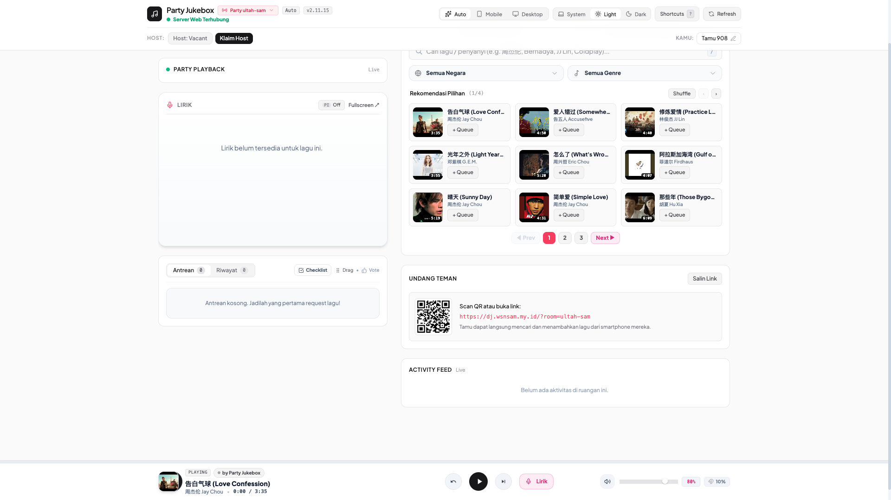
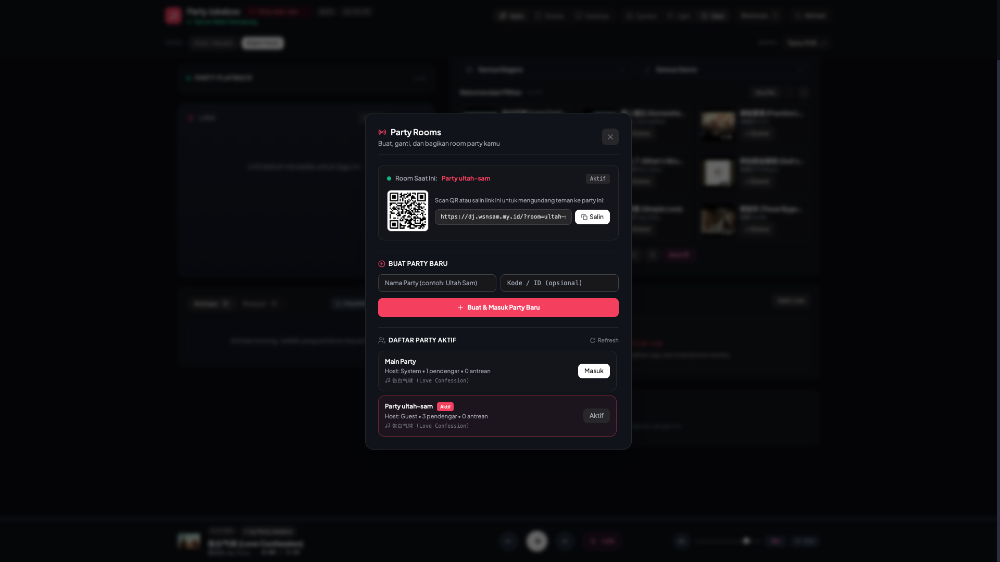

<div align="center">


# 🎵 Party Jukebox
### Connect. Queue. Sing Together.

> **Collaborative, real-time social jukebox & karaoke hub for house parties, roadtrips, and hangouts.**  
> Host your music in the cloud or on local speakers, while friends control the queue, vote, read synchronized karaoke lyrics, and DJ from their smartphones—**zero app installation and zero login required for guests!**

[](https://dj.wsnsam.my.id)
[](https://github.com/sammmms/jukebox)
[](https://github.com/sammmms/jukebox)
[](https://lucide.dev)
[](LICENSE)

</div>

---

## 🌐 Live Cloud Deployment

Party Jukebox is deployed and accessible worldwide at:

### 🔗 **[https://dj.wsnsam.my.id](https://dj.wsnsam.my.id)**

- **Instant Join:** Open the link or scan the room's dynamic QR code with any smartphone.
- **Multi-Party Support:** Create your own room (e.g. `https://dj.wsnsam.my.id/?room=ultah-sam`) or join the default `Main Party`.
- **Zero Server Overhead:** Powered by Vercel Serverless Functions and YouTube Web Player API with automatic idle-room cleanup (> 30 min inactivity).

---

## 📸 Showcase & Preview

<div align="center">

### 💻 Widescreen Desktop Dashboard (Dark Mode)


<br/>

### ☀️ Apple-Style Clean Light Theme


<br/>

### 👥 Multi-Party Rooms Switcher & Dynamic QR Code Sharing


<br/>

| 📱 Mobile Phone View (iPhone) | 🎤 Synced Karaoke Real-Time Lyrics |
| :---: | :---: |
|  |  |

</div>

---

## ✨ Core Features

### 1. 👥 Multi-Party Isolated Rooms
- **Multiple Rooms Simultaneously:** Users and groups can create separate, fully isolated parties (e.g., `Room Ultah`, `Room Kantor`, `Room Chill`).
- **Dedicated State per Room:** Each room features its own independent queue, host speaker seat, playback tracker, activity feed, and history.
- **Dynamic 1-Click Sharing & QR:** Setiap room menghasilkan direct share link (`/?room=...`) dan QR code dinamis yang siap di-scan langsung oleh kamera smartphone tamu.
- **Auto-Cleanup Inactive Rooms:** Room yang tidak aktif (> 30 menit tanpa pendengar) otomatis dibersihkan untuk menghemat resource serverless.

### 2. ⚡ Zero-Failure YouTube Web Player Engine
- **Cloud-Native Playback:** Menggunakan pemutar resmi YouTube Web Player (`YT.Player`) yang streaming langsung dari CDN Google ke browser tanpa membebani server backend.
- **Automatic Fallback Watchdog:** Jika koneksi audio lokal atau proxy native terputus, sistem seketika beralih ke YouTube Web Player secara transparan tanpa jeda atau error.

### 3. 🎨 Anti-Slop UI with Lucide Vector Icons
- **Pixel-Perfect Vector Graphics:** 100% bebas emoji di kontrol interaktif. Menggunakan library `lucide` untuk semua kontrol pemutar, navigasi segmented pills, modal, drawer, dan notifikasi toast.
- **Rigid Single-Line Segmented Controls:** View switcher (`Auto`, `Mobile`, `Desktop`) dan theme switcher (`System`, `Light`, `Dark`) terkunci rapi secara horizontal.

### 4. 🎤 Real-Time Karaoke Synced Lyrics
- **Sub-Second Syllable Synchronization:** Menampilkan lirik lagu real-time dari LRCLib API dengan auto-scroll dan glow highlight pada bait yang sedang dinyanyikan.
- **Trilingual Romanization:** Tombol toggle instan untuk menampilkan Pinyin (Mandarin), Romaji (Jepang), atau Romaja (Korea) agar semua orang bisa ikut bernyanyi.

### 5. 🗳️ Collaborative Crowd DJ Queue
- **Frictionless Mobile Request:** Tamu cukup scan QR code dan mencari judul lagu atau menempelkan URL YouTube / Playlist.
- **Upvote Prioritization:** Tamu dapat melakukan upvote pada lagu di antrean (`Upvote`); lagu dengan vote tertinggi otomatis naik prioritas untuk diputar berikutnya.
- **Touch Drag-and-Drop Reordering:** Host dapat mengatur ulang urutan antrean dengan mudah menggunakan drag handle bertenaga SortableJS.
- **Host Seat Takeover:** Sistem serah-terima kursi Host Speaker dengan konfirmasi otomatis dan countdown ring timer.

---

## 🚀 Quick Start Guide (Local Development / Self-Hosted)

### 📋 Prerequisites

- **Node.js** (v18.0.0 or later): [Download Node.js](https://nodejs.org/)
- **npm** or **pnpm**

---

### 💻 Step 1: Clone & Install

```bash
# Clone the repository
git clone https://github.com/sammmms/jukebox.git
cd jukebox

# Install dependencies
npm install
```

---

### 🎧 Step 2: Run Locally

```bash
# Jalankan server Jukebox
npm start
```

Terminal akan menampilkan IP lokal dan QR code:
```text
======================================================
🎵  PARTY JUKEBOX READY!
======================================================
📡 Local Network URL: http://192.168.0.193:3000
💻 Host URL:          http://localhost:3000
======================================================
📲 SCAN WITH PHONE TO OPEN:
[ QR Code renders in your terminal ]
======================================================
```

Buka `http://localhost:3000` di laptop host, dan teman-teman di jaringan Wi-Fi yang sama dapat langsung scan QR code dari smartphone mereka.

---

### ☁️ Step 3: Deploy to Vercel

```bash
# Build dan deploy ke Vercel production
vercel build --prod
vercel deploy --prebuilt --prod
```

Konfigurasi serverless telah terintegrasi di `vercel.json` dan siap melayani multi-party room di domain publik kamu.

---

## 🛠️ Architecture Overview

```
                      ┌────────────────────────────────────────────────────────┐
                      │              Vercel Serverless Edge / Cloud             │
                      │               https://dj.wsnsam.my.id                  │
                      │                                                        │
                      │   ┌────────────────────────────────────────────────┐   │
                      │   │       RoomManager (Multi-Party Engine)         │   │
                      │   │   - Isolated Room Queues & Playback Trackers   │   │
                      │   │   - Server-Sent Events (SSE) Live Broadcast    │   │
                      │   │   - LRCLib Karaoke Synced Lyrics Integration   │   │
                      │   │   - Auto-Cleanup for Idle Rooms (> 30 min)     │   │
                      │   └────────────────────────┬───────────────────────┘   │
                      └────────────────────────────┼───────────────────────────┘
                                                   │ SSE + REST /api/*
                      ┌────────────────────────────┼───────────────────────────┐
                      │                            │                           │
          ┌───────────▼───────────┐   ┌────────────▼──────────┐   ┌────────────▼──────────┐
          │  👑 Host Device       │   │  📱 Guest DJ (Alex)   │   │  📱 Guest DJ (Cia)    │
          │  - YouTube Web Player │   │  - Queue Search       │   │  - Upvote Songs       │
          │  - Master Audio Play  │   │  - Karaoke Lyrics     │   │  - Room Switcher      │
          │  - QR Code Display    │   │  - Mobile View        │   │  - Dynamic DJ Profile │
          └───────────────────────┘   └───────────────────────┘   └───────────────────────┘
```

---

## 📜 License

MIT License. Designed and crafted with precision for friends, parties, and music lovers.
